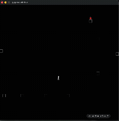

# neat-platformer-agent

A 2D platformer where the character isn't controlled by a human or trained by gradient descent — it's evolved. I built a simple Pygame platformer (platforms, gravity, jumping, a food pickup) and used [NEAT](https://neat-python.readthedocs.io/) (NeuroEvolution of Augmenting Topologies) to evolve a population of neural networks that learn to jump between platforms and reach the food, generation by generation.

No AI tools were used to write any of this code (apart from this README) — every line here is hand-written, and that's intentional. It's meant to demonstrate that I can build and reason about this stuff myself, and I'm keeping it that way going forward.

## Demo



## How it works

- `Platform`, `Food`, and the agent (`Person`) are Pygame sprites with manual collision handling and custom gravity/jump physics.
- Each generation, NEAT evolves a population of small feed-forward neural networks. A network's inputs are a flattened vector of platform positions/sizes and distances to food; its outputs are interpreted as left / right / jump key presses.
- Fitness rewards climbing to new platforms and reaching the food, and penalizes falling or getting stuck in place.
- `random_gen_map.py` generates a fresh, randomized platform layout every run, so a good genome has to generalize rather than memorize one fixed course.

## Files

- `random_gen_map.py` + `random_level_run.py` — the current version: procedurally generated platform layouts, trains a NEAT population from scratch, then loops replaying the best genome it finds
- `easy_level_save.py` + `easy_level_solved.py` — an earlier, fixed-layout version. `easy_level_solved.py` just loads the pretrained genome below and replays it instantly, no training wait
- `winner.pkl` — a pretrained genome that already clears the fixed-layout obstacle course
- `pure_game.py` / `final_level.py` — the original hand-built, keyboard-controlled platformer (no NEAT) that the evolved version was built on top of
- `config-xor` — NEAT hyperparameters (population size, inputs/outputs, mutation rates, etc.)

## Running it

```
pip install pygame neat-python
```

Instant demo (replays a genome that already knows how to clear the course):
```
python easy_level_solved.py
```

Train a new agent from scratch on randomized maps:
```
python random_level_run.py
```

Play the original platformer yourself, no AI involved:
```
python final_level.py
```

## Where this is going

The goal is to grow this into something closer to a multi-agent survival ecosystem — think *Rain World* — rather than one agent clearing one course. A couple of early pieces are already in place toward that:
- `pure_game.py` / `final_level.py` already track `hunger` and a couple of other needs-based attributes on the agent, unused by the current NEAT scripts but there as a starting point for a needs-driven agent instead of a pure "reach the food" fitness function.
- The procedural map generation in `random_gen_map.py` means the world isn't fixed, which is a prerequisite for anything ecosystem-like.

Next steps would be running multiple agents in the same world simultaneously (instead of evaluating genomes one at a time) and building out real survival pressure (hunger decay, threats, competition for food) rather than a single fitness score.

## Known rough edges

This was built iteratively while learning NEAT, so there's duplicated game-engine code (the `Platform`/`Food`/`Person` classes are copy-pasted with small tweaks across a few files rather than shared), no tests, and some constants that are hardcoded rather than configurable. Left as-is rather than cleaned up after the fact, per the no-AI-assistance point above.
